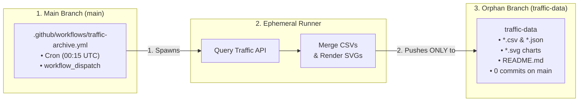
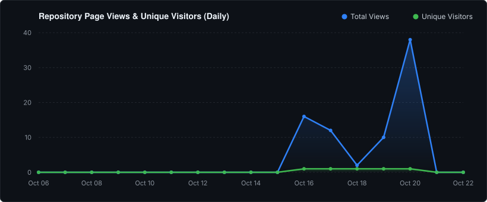
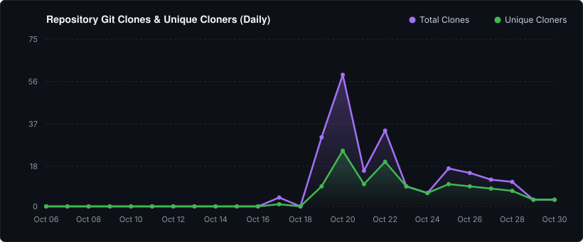

# 📊 Claude Autopilot — Traffic & Adoption Dashboard

*Last updated: 2026-10-28 05:32 UTC*

This branch (`traffic-data`) permanently archives repository telemetry, overcoming GitHub's 14-day rolling window deletion policy. All time-series data is persisted exclusively to this orphan branch, keeping `main` 100% clean.

---

## 📈 Lifetime Key Performance Indicators (KPIs)

| Metric | All-Time Total |
| :--- | :--- |
| **Total Page Views** | 79 |
| **Cumulative Daily Uniques** | 6 |
| **Total Git Clones** | 191 |
| **Unique Git Cloners** | 99 |

---

## 📉 Views & Visitor Trends

---

## 📦 Git Clones Trend

---

## 🌐 Top Referring Domains (All-Time)

| Domain | Total Hits | Unique Visitors | % of Total Traffic |
| :--- | :--- | :--- | :--- |
| `github.com` | 1 | 1 | 100.0% |

---

## 📄 Top Documentation Paths (Document Heatmap)

| Document / Path | Page Views | Unique Readers |
| :--- | :--- | :--- |
| **/pulls** (`/urvijain02/claude-autopilot/pulls`) | 62 | 9 |
| **/actions** (`/urvijain02/claude-autopilot/actions`) | 35 | 7 |
| **/pull/4** (`/urvijain02/claude-autopilot/pull/4`) | 35 | 7 |
| **/pull/2** (`/urvijain02/claude-autopilot/pull/2`) | 27 | 9 |
| **/actions/workflows/traffic-archive.yml** (`/urvijain02/claude-autopilot/actions/workflows/traffic-archive.yml`) | 21 | 7 |
| **/actions/runs/39072240583/job/117512071539** (`/urvijain02/claude-autopilot/actions/runs/39072240583/job/117512071539`) | 9 | 9 |
| **/actions/runs/39072240583/job/117512071719** (`/urvijain02/claude-autopilot/actions/runs/39072240583/job/117512071719`) | 9 | 9 |
| **/actions/runs/39410164482** (`/urvijain02/claude-autopilot/actions/runs/39410164482`) | 7 | 7 |
| **/actions/runs/39410164482/job/118585688863** (`/urvijain02/claude-autopilot/actions/runs/39410164482/job/118585688863`) | 7 | 7 |
| **/actions/runs/39413793156** (`/urvijain02/claude-autopilot/actions/runs/39413793156`) | 6 | 6 |
| **/activity** (`/urvijain02/claude-autopilot/activity`) | 2 | 2 |
| **/commits/main** (`/urvijain02/claude-autopilot/commits/main`) | 2 | 2 |
| **/compare/phase-4-telemetry** (`/urvijain02/claude-autopilot/compare/phase-4-telemetry`) | 2 | 2 |
| **/compare/phase-5-dev-ergonomics** (`/urvijain02/claude-autopilot/compare/phase-5-dev-ergonomics`) | 2 | 2 |
| **/pull/2/commits** (`/urvijain02/claude-autopilot/pull/2/commits`) | 2 | 2 |

---

*Automated repository telemetry archived nightly at 00:15 UTC via Claude Autopilot Traffic Archiver.*
