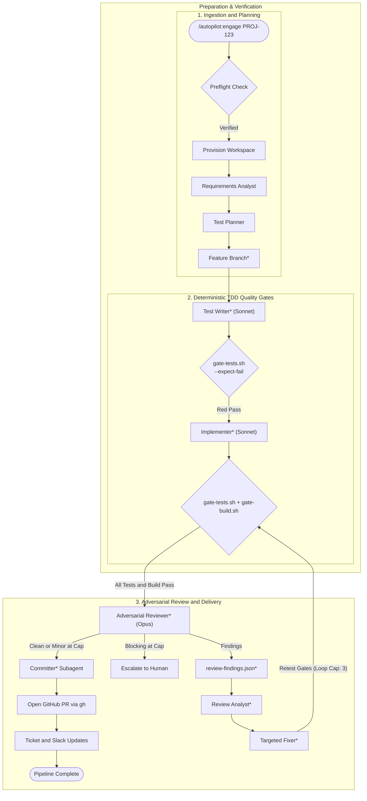
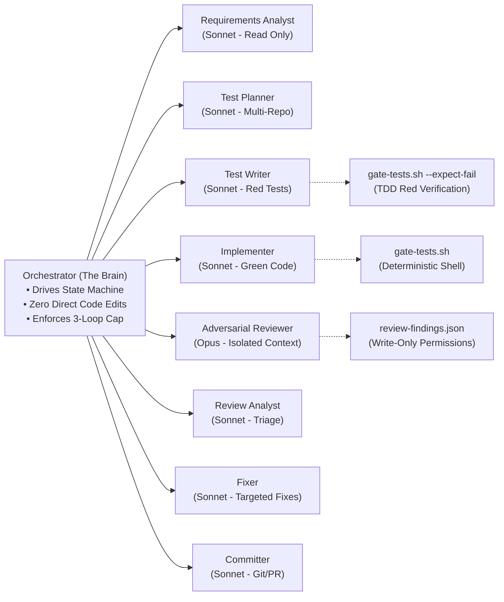

# Claude Autopilot: Model-Agnostic Autonomous SWE-Agent Pipeline

[](#-is-this-locked-into-anthropics-claude-ecosystem)
[](#two-kinds-of-gate-dont-confuse-them)
[](#architecture--state-machine)
[](LICENSE)

Takes a Jira ticket or GitHub issue through to open pull requests without supervision.

Failing tests are written before the production change, stage outcomes are decided by shell scripts rather than by the model reading its own work, and the review is done by a separate agent on a stronger model tier than the one that wrote the code — then looped through analyze and fix. At the iteration cap it escalates if anything blocking survives, and ships with the leftovers recorded if only minor findings remain.

It works across several repos in one run, clones what it needs into a throwaway workspace (nothing has to be checked out beforehand), and picks up where it left off if a run is interrupted.

---

## Architecture & State Machine

The pipeline operates as an explicit finite-state machine backed by disk-persisted state (`$STATE/state.json`), ensuring crash resilience and resumability. For formal JSON schemas, convergence guarantees, and quality gate contracts, see the [System Architecture Specification (RFC-001)](docs/SPECIFICATION.md).



> [!NOTE]
> **Multi-Repo Fan-Out (`*`):** Stages marked with an asterisk (`*`) automatically fan out per repository recorded in `state.json.repos[]`. Each repository executes isolated quality gates and review passes, while coordinating against the shared test plan in `$STATE/test-plan.md`.

### Multi-Repo Coordination Architecture

Real-world engineering tickets frequently span multiple repositories (e.g. updating a schema or API contract in a backend microservice, then updating client callers and frontend components in dependent repositories). Claude Autopilot coordinates this atomically without pre-cloning:

* **Dynamic Dependency Discovery:** The `requirements-analyst` inspects ticket specifications and detects connected repositories without requiring hardcoded repository mappings.
* **Isolated Clones, Unified Plan:** Each repository is cloned into an isolated disposable workspace (`~/.claude/autopilot/work/<TICKET>/repos/<REPO>`). Subagents author code independently in each repository, but coordinate contract boundaries against a shared multi-repo plan (`$STATE/test-plan.md`).
* **Atomic Cross-Linked Pull Requests:** When quality gates pass across all affected repositories, the `committer` subagent authors conventional commits per repo, opens individual PRs, and cross-links sibling PR URLs in each PR description for synchronized team reviews.

### Asymmetric Subagent Hierarchy & Context Isolation

To eliminate LLM sycophancy (models rubber-stamping their own mistakes), the authoring and review roles are strictly decoupled into isolated contexts across asymmetric model tiers:



---

## 🛠️ Supported Target Languages & Tech Stacks

Claude Autopilot is designed to write code and verify tests across any programming language. Stack detection and deterministic gates are handled by modular POSIX scripts in `bin/`:

| Ecosystem / Stack | Detection Manifest | Deterministic Build Gate | Deterministic Test Gate | Out-of-the-Box Status |
| :--- | :--- | :--- | :--- | :---: |
| **Node.js / TypeScript** | `package.json` | `npm run build` / `typecheck` / `tsc` | `npm test` (native `node:test`, Jest, Vitest, Mocha) | ✅ **Shipped** |
| **.NET (C# / F#)** | `*.sln`, `*.slnx`, `*.csproj` | `dotnet build` | `dotnet test` (with offline feed fallback) | ✅ **Shipped** |
| **Python** | `pyproject.toml`, `requirements.txt` | `python -m py_compile` | `pytest` | ⚡ *Easily extensible (see [Guide](CONTRIBUTING.md#3-extending-language-support-for-target-repositories-eg-rust-go-python))* |
| **Rust** | `Cargo.toml` | `cargo check --tests` | `cargo test` | ⚡ *Easily extensible (see [Guide](CONTRIBUTING.md#3-extending-language-support-for-target-repositories-eg-rust-go-python))* |
| **Go** | `go.mod` | `go build ./...` | `go test ./...` | ⚡ *Easily extensible (see [Guide](CONTRIBUTING.md#3-extending-language-support-for-target-repositories-eg-rust-go-python))* |

> **Extending to New Stacks:** Adding support for any compiled or interpreted language requires only adding a `case` statement to `bin/detect-stack.sh`, `bin/gate-build.sh`, and `bin/gate-tests.sh`. See the [Contributor Walkthrough](CONTRIBUTING.md#3-extending-language-support-for-target-repositories-eg-rust-go-python).

---

## ❓ Is this locked into Anthropic's Claude ecosystem?

**No.** While distributed as a 1-click plugin for Claude Code, the core architecture is strictly provider-agnostic:

1. **Un-fakeable Shell Gates:** All build and test verdicts come from deterministic shell scripts (`gate-tests.sh`, `gate-build.sh`), not model self-reporting. The model cannot hallucinate or argue past failing exit codes.
2. **Standardized JSON State Protocol:** The orchestrator communicates via vendor-neutral JSON schemas (`state.json`, `review-findings.json`, `fix-list.json`). Any frontier model—OpenAI (GPT-4o/o3), Google Gemini, DeepSeek, or local open-weights models (Ollama/vLLM)—can drive the subagent briefings.
3. **Universal Loop Design:** The state machine is designed to transcribe directly into a standalone TypeScript or Python agent loop (`while state.phase !== 'done'`).
   <details>
   <summary><b>View Universal Loop Implementation (TypeScript / Python)</b></summary>

   ```typescript
   // Standalone TypeScript/Python loop over disk-persisted state
   while (state.phase !== 'done' && state.phase !== 'escalated') {
     const subagent = getSubagentForPhase(state.phase);
     await subagent.execute(state);
     
     // Gate verdicts decide transition — zero model self-grading:
     state = await reloadStateFromDisk(stateDir);
   }
   ```
   </details>

---

## Install

```bash
/plugin marketplace add urvijain02/claude-autopilot
```

```bash
/plugin install autopilot@claude-autopilot
```

Restart Claude Code afterwards. On the next start, `~/.claude/autopilot/config.json` is created for you from the shipped template.

## Set up

**Nothing is strictly required** — the pipeline runs with the config exactly as shipped. The one value worth setting first is `slack_channel`: without it the PR-link post is skipped and logged rather than sent somewhere arbitrary.

Your config is at `~/.claude/autopilot/config.json`, created on first start. (`AUTOPILOT_HOME` moves it — see [Where things live](#where-things-live).)

| Key | Ships as | What it does |
|---|---|---|
| `slack_channel` | *empty* | Channel id (`C0…`) the PR links get posted to. Empty means the post is skipped and logged. |
| `jira_site` | *empty* | Optional. Host for Atlassian Cloud (e.g. `your-team.atlassian.net`). If empty, Jira transitions skip and prompt-mode applies. |
| `human_gates` | `false` | `true` pauses for plan approval and pre-commit sign-off. No effect on the quality gates — see *Two kinds of gate*. |
| `cleanup_after_pr` | `false` | `true` deletes a ticket's clones once its PRs are open. A run's output under `state_root` is kept either way. |
| `default_base_branch` | `main` | Base branch to branch from when the ticket doesn't imply one. |
| `state_root` | `~/.claude/autopilot/state` | Where a run's durable output lands. Point it somewhere browsable if you'd rather read runs outside `~/.claude`. A value containing a quote or backslash needs `jq` or `python3` — see *Requirements*. |
| `workspace_root` | `~/.claude/autopilot/work` | Where the throwaway clones go. Move it if the repos you work on are large. |
| `orgs` | `[]` | Optional. GitHub orgs or username searched to resolve a connected repo that analysis names. Empty means you're always asked for the link. Bare `owner/repo` is GitHub-only; Bitbucket needs a full URL. |
| `auto_expand_connected` | `false` | `true` clones connected repos without confirming each one first. |
| `jira_transitions` | `{}` | Fills itself in. The first time a project's in-progress or in-review status can't be matched automatically you're asked once, and the answer is cached per project key. |

## Requirements

| Need | Missing means |
|---|---|
| `gh`, authenticated | **Critical** — no cloning private repos, no PRs |
| `git` | **Critical** — no branches or commits |
| An Atlassian MCP — the standalone server or the claude.ai connector | Jira steps skip: the ticket isn't assigned or moved |
| Slack MCP | The PR-link post skips |
| `jq` **or** `python3` | Optional. Only needed to read `state_root` / `workspace_root` out of your config when the value isn't a plain one-line string. With neither installed and such a value set, the scripts stop rather than silently write gate output somewhere the pipeline won't read it. |

`preflight` checks the first four before anything else runs and tells you exactly what will be skipped, so a missing tool surfaces up front rather than three stages in.

**Cross-Platform Support:** Runs natively on macOS and Linux (via `/bin/bash`). On Windows, runs through Git Bash (bundled with Git for Windows) or WSL. While distributed as a 1-click plugin for Claude Code, the state protocol and shell gates are model-agnostic and can be orchestrated by any frontier model or autonomous agent framework.

## Use it

```
/autopilot:engage PROJ-123
```

It also answers to plain requests — "run autopilot on PROJ-123", "engage autopilot on PROJ-123".

Re-running on a ticket already underway **resumes** it from `state.json` rather than starting over:

```
/autopilot:engage PROJ-123                  resume, or start if it's new
/autopilot:engage PROJ-123 --from review    redo from a named phase
/autopilot:engage PROJ-123 --restart        start over (asks first; archives the old run)
/autopilot:engage                          list every run that isn't finished
```

One invocation carries the ticket all the way to open PRs — it doesn't stop to ask you to approve anything. If the session dies partway, nothing is lost: state is on disk after every transition, so running the same command again picks up where it stopped.

One ticket per run.

### Two kinds of gate, don't confuse them

"Unsupervised" means nobody is asked to click approve. It does not mean unchecked.

- **Quality gates** — tests and build, run by shell scripts that write `pass`/`fail` to disk. The orchestrator has to read those files before it advances. Always on, not configurable, and the reason the run can be trusted without you watching it.
- **Human gates** — the pauses for you to approve a plan or sign off before commit. Off by default. Set `human_gates: true` in your config if you'd rather it stop and wait at those points.

## Where things live

| | |
|---|---|
| The plugin's own scripts | inside the installed plugin — you never need this path |
| `~/.claude/autopilot/config.json` | your settings |
| `~/.claude/autopilot/state/<TICKET>/` | a run's output: spec, test plan, findings, gate verdicts, `log.md` |
| `~/.claude/autopilot/work/<TICKET>/repos/` | the throwaway clones |

Those paths are defaults. `state_root` and `workspace_root` in your config move the last two, and the `AUTOPILOT_HOME` environment variable moves all of it at once — it's the anchor the rest hang off, resolved in one place (`bin/_paths.sh`). Everything under it is yours and survives plugin updates. No pipeline artifact is ever written into a repo: the spec, plan, findings, gate verdicts and `log.md` all live under `state_root`. The clone itself does accumulate ordinary build output — `obj/`, `bin/`, `node_modules/` — because the gates run real build and test commands inside it. That's the reason the clone is disposable and the state dir isn't.

To relocate the root workspace and config:

```bash
# macOS / Linux (in ~/.bashrc or ~/.zshrc)
export AUTOPILOT_HOME="$HOME/.custom-autopilot"

# Windows (in PowerShell profile or Environment Variables)
$env:AUTOPILOT_HOME = "D:\autopilot"
```

## Permission prompts

The gate and provision scripts run through **POSIX Bash** (native on macOS/Linux; via Git Bash or WSL on Windows), so the first time each one is used you'll get a permission prompt showing its full path. Choosing the always-allow option persists it, and after the first run you won't see them again. If you'd rather pre-approve them, copy the paths out of those prompts into your own settings — they're stable for an installed version.

## Reading a run

The session output is deliberately thin — one line per stage and a summary block at the end. Everything else is on disk under `state_root/<TICKET>/`: `requirements.md`, `test-plan.md`, `review-findings-*.json`, `fix-list-*.json`, the gate verdicts under `gates/`, and `log.md`, which carries every decision the run made along with why and what it rejected.

## Releasing

The version appears in **two** files and both must be bumped together — `.claude-plugin/plugin.json` and the plugin's entry in `.claude-plugin/marketplace.json`. Bump one and the marketplace advertises a version that differs from what installs.

## Documentation & Community

* [System Architecture Specification (RFC-001)](docs/SPECIFICATION.md) — State machine mathematical formalism, data protocols, quality gate contracts, and convergence proofs.
* [Security Policy & Trust Model](SECURITY.md) — Agent workspace sandboxing, permission quarantining, and deterministic guardrail layers.
* [Contributor Guide](CONTRIBUTING.md) — Local development setup, stack extensibility walkthrough, and subagent prompt standards.
* [Changelog](CHANGELOG.md) — Release notes and version history.

## Citation & Attribution

If this autonomous architecture, TDD quality gate design, or state-protocol informs your research, engineering projects, or agent pipelines, please attribute the work:

```bibtex
@software{jain2026claudeautopilot,
  author = {Urvi Jain},
  title = {Claude Autopilot: Autonomous SWE-Agent Pipeline with Deterministic TDD Quality Gates},
  year = {2026},
  publisher = {GitHub},
  journal = {GitHub repository},
  howpublished = {\url{https://github.com/urvijain02/claude-autopilot}}
}
```

Or reference in markdown:
> **Claude Autopilot** by [Urvi Jain](https://github.com/urvijain02) — [github.com/urvijain02/claude-autopilot](https://github.com/urvijain02/claude-autopilot)

## Maintainer

[Urvi Jain](https://github.com/urvijain02). Open an issue on this repo for bugs, or send a PR.
