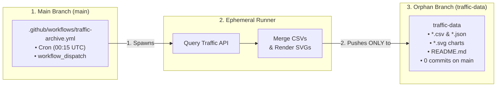

# 📊 Claude Autopilot — Traffic & Adoption Dashboard

*Last updated: 2026-10-20 11:16 UTC*

This branch (`traffic-data`) permanently archives repository telemetry, overcoming GitHub's 14-day rolling window deletion policy. All time-series data is persisted exclusively to this orphan branch, keeping `main` 100% clean.

---

## 📈 Lifetime Key Performance Indicators (KPIs)

| Metric | All-Time Total |
| :--- | :--- |
| **Total Page Views** | 40 |
| **Cumulative Daily Uniques** | 4 |
| **Total Git Clones** | 35 |
| **Unique Git Cloners** | 10 |

---

## 📉 Views & Visitor Trends

---

## 📦 Git Clones Trend

---

## 🌐 Top Referring Domains (All-Time)

| Domain | Total Hits | Unique Visitors | % of Total Traffic |
| :--- | :--- | :--- | :--- |
| *No referral data recorded yet* | — | — | — |

---

## 📄 Top Documentation Paths (Document Heatmap)

| Document / Path | Page Views | Unique Readers |
| :--- | :--- | :--- |
| **/pull/2** (`/urvijain02/claude-autopilot/pull/2`) | 3 | 1 |
| **/pulls** (`/urvijain02/claude-autopilot/pulls`) | 3 | 1 |
| **/actions/runs/39072240583/job/117512071539** (`/urvijain02/claude-autopilot/actions/runs/39072240583/job/117512071539`) | 1 | 1 |
| **/actions/runs/39072240583/job/117512071719** (`/urvijain02/claude-autopilot/actions/runs/39072240583/job/117512071719`) | 1 | 1 |
| **/activity** (`/urvijain02/claude-autopilot/activity`) | 1 | 1 |
| **/commits/main** (`/urvijain02/claude-autopilot/commits/main`) | 1 | 1 |
| **/compare/phase-4-telemetry** (`/urvijain02/claude-autopilot/compare/phase-4-telemetry`) | 1 | 1 |
| **/compare/phase-5-dev-ergonomics** (`/urvijain02/claude-autopilot/compare/phase-5-dev-ergonomics`) | 1 | 1 |
| **/pull/2/commits** (`/urvijain02/claude-autopilot/pull/2/commits`) | 1 | 1 |
| **/releases** (`/urvijain02/claude-autopilot/releases`) | 1 | 1 |

---

*Automated repository telemetry archived nightly at 00:15 UTC via Claude Autopilot Traffic Archiver.*
